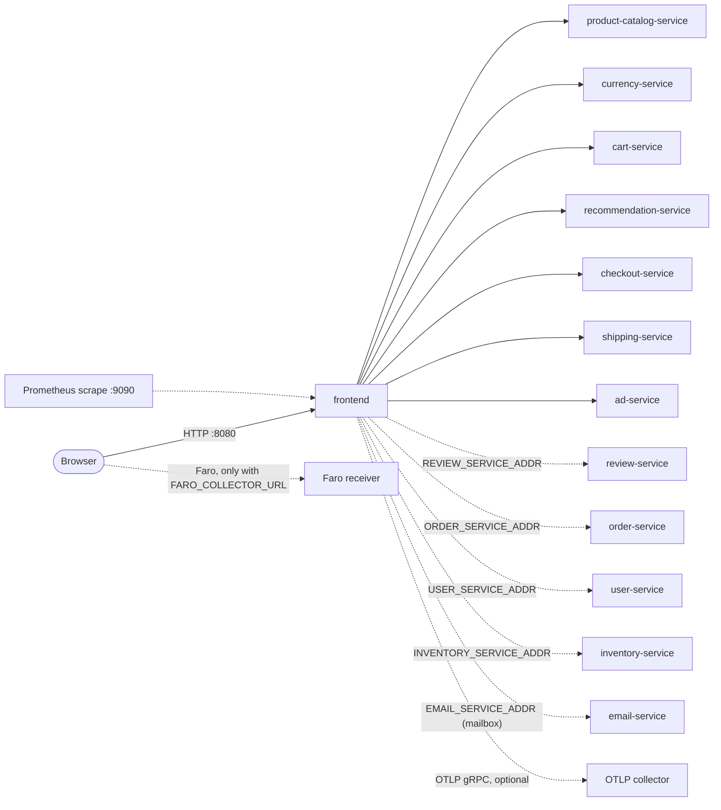
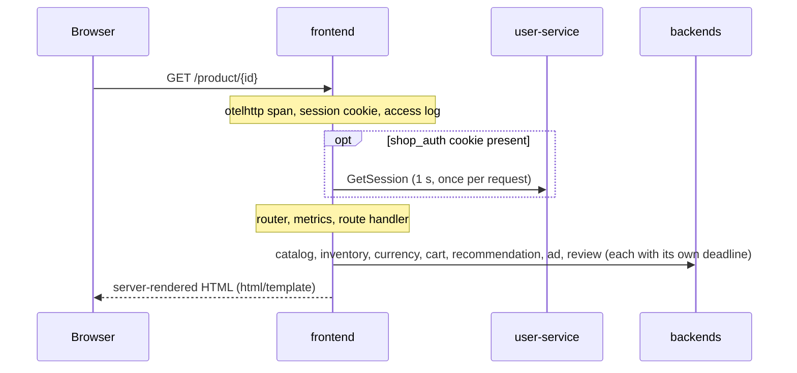

# Architecture

## Context

The frontend is the only component that browsers (and the ingress) talk to; every other service is reached from it over gRPC. The address variables of the seven solid dependencies are required: without one the process exits at start with one JSON error line (`mustMapEnv` in `cmd/server/main.go`). The connections themselves are lazy. The dotted ones are switched on by their address variable: an empty value turns the feature off and the page that needs it answers `404` or leaves the block out. The mailbox needs both `EMAIL_SERVICE_ADDR` and `ORDER_SERVICE_ADDR` (the orders say whose mail is whose). `payment-service` is reached only through `checkout-service`.

## Request path

The middleware chain is built in `newHandler` (`cmd/server/main.go`), outermost first: OpenTelemetry HTTP handler (span named after the route template), session-id cookie, structured request log, Content-Security-Policy header, `withUser` (the `shop_auth` cookie to `user-service.GetSession`), then the router (`gorilla/mux`) whose routes are wrapped with the Prometheus metrics middleware. Which backends each page calls, with their deadlines, is the table "Which backend each page calls" in the README.

## Components

| Where | Role |
|---|---|
| `cmd/server/main.go` | environment wiring, gRPC dials (lazy `grpc.NewClient`), router, middleware chain, HTTP server, graceful drain |
| `cmd/server/handlers.go`, `browse.go`, `cart.go`, `orders.go`, `accounts.go`, `mailbox.go`, `reviews.go`, `inventory.go`, `ads.go` | one page family each; `rpc.go` has the backend calls and their deadlines |
| `cmd/server/errors.go` | gRPC status to error page, cached department navigation |
| `cmd/server/currency_cache.go` | in-process cache of currency-service answers ([ADR 2](adr/0002-cache-currency-answers-in-process.md)) |
| `cmd/server/product_cache.go` | 30 s in-process cache of `GetProduct` for cart lines and recommendations ([ADR 4](adr/0004-cache-product-lookups-instead-of-a-batch-rpc.md)); `fetchProducts` in `rpc.go` runs lookups in parallel |
| `cmd/server/csp.go` | Content-Security-Policy header (report-only by default) and the `/csp-report` receiver ([ADR 5](adr/0005-content-security-policy-report-only-first.md)) |
| `cmd/server/static.go` | `/static/*` with cache headers, ETag, gzip, no cookie |
| `cmd/server/health.go` | `/healthz`, `/readyz`, `/version` and the `healthcheck` subcommand |
| `cmd/server/telemetry.go`, `faro.go`, `internal/obs/` | metrics, spans, logs, profiles and the browser RUM settings |
| `templates/`, `static/` | HTML templates, CSS, vendored htmx, product photos |
| `genproto/` | generated stubs of every backend (the order, user, inventory and mailbox contracts are packages of their own) |

## State

None on the server. The visitor's session id is a cookie; carts live in cart-service, orders in order-service, accounts in user-service. The cookies are `Secure`, so carts only work over HTTPS or on `localhost` (see [Operations](operations.md)).

## Decisions

[ADR 1](adr/0001-server-rendered-html-with-htmx.md), [ADR 2](adr/0002-cache-currency-answers-in-process.md), [ADR 3](adr/0003-readiness-checks-only-the-pages-core.md), [ADR 4](adr/0004-cache-product-lookups-instead-of-a-batch-rpc.md), [ADR 5](adr/0005-content-security-policy-report-only-first.md).
